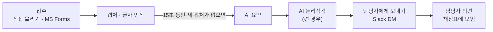

# 아이디어정리

[](https://github.com/realmi-lab/idea_review/actions/workflows/ci.yml)

**사내 공모에 들어온 제안을 읽고, AI 요약으로 정리하고, 담당자 의견을 모으는 앱**입니다. 저장소 이름은 `idea_review`입니다(예전 `contest-review`). PDF·Word·PowerPoint·Excel·이미지를 쪽마다 캡처해 글자를 읽고, AI가 핵심·세부 요약을 만듭니다. 담당자는 Slack DM으로 받은 자료를 보고 의견을 보냅니다.

AI 키가 없어도 접수·캡처·글자 인식은 바로 쓸 수 있습니다. 키를 넣으면 캡처가 끝날 때마다 요약이 **저절로** 만들어집니다.

## 한 건이 흘러가는 순서



| 단계 | 사람이 할 일 | 저절로 되는 일 |
|---|---|---|
| 접수 | 파일을 끌어 놓거나, Forms 연동을 켜 둠 | Forms 응답과 첨부를 1분마다 가져옴 |
| 캡처 자료 | 쪽 순서·글자를 훑어보고, 이상한 쪽만 다시 캡처 | 쪽마다 캡처하고 글자를 읽음 |
| AI 요약 | 핵심 요약 읽기, 근거 쪽 열어 보기 | 캡처가 끝나면 요약 시작, 화면도 AI 요약 탭으로 이동 |
| AI 논리점검 | 수치·논리 의문점 확인 | 요약에 이어서 실행 |
| 채점표 | 담당자에게 보내기, 메모 | 담당자 의견을 1분마다 읽어 옴 |

## 실행

Git과 **Node.js 22.21 이상**이 필요합니다. 첫 실행은 npm 패키지를 받으므로 인터넷(또는 회사 프록시)이 필요합니다.

**Mac · 터미널**

```sh
git clone https://github.com/realmi-lab/idea_review.git ~/git/idea_review
cd ~/git/idea_review
./start.sh
```

Node가 없으면 스크립트가 nvm으로 준비합니다.

**Windows · PowerShell**

```powershell
git clone https://github.com/realmi-lab/idea_review.git "$HOME\git\idea_review"
Set-Location "$HOME\git\idea_review"
.\start.bat
```

다음부터는 탐색기에서 **start.bat**을 더블클릭해도 됩니다. Node가 없으면 `winget`으로 설치를 시도합니다(없으면 [Node.js LTS](https://nodejs.org/en/download)를 설치하고 새 창에서 다시 실행).

[http://localhost:18765](http://localhost:18765)에서 엽니다(Windows는 브라우저가 저절로 열립니다). 끄려면 실행 창에서 `Ctrl+C`를 누르거나 창을 닫습니다.

1. 작품명을 넣어 **작품 접수**를 누릅니다.
2. **캡처 자료**에 시험용 PNG 한 장을 올리고 읽힌 글자가 나오는지 봅니다.
3. 여기까지 되면 설치는 끝입니다. 아래 ‘처음 한 번 설정’에서 쓸 기능만 켜세요.

## 처음 한 번 설정

필요한 것만 하면 됩니다. 1번은 Forms나 Slack을 쓸 때만 필요합니다.

**1. 설정 파일 만들기** · Forms·Slack·사내망 설정은 `deploy/site.json` 한 파일에 둡니다. 없으면 예시를 복사합니다.

```sh
cp deploy/site.example.json deploy/site.json
```

Windows PowerShell은 `Copy-Item deploy\site.example.json deploy\site.json`입니다. 이 파일에는 웹훅 주소 같은 비밀 값이 들어가므로 Git에 올리지 않습니다(이미 제외되어 있음).

**2. AI 요약 켜기** · 왼쪽 아래 **설정(톱니바퀴) → 요약 설정**에 키를 넣고 저장합니다. 저장할 때 연결을 확인합니다.

| 쓰는 곳 | 키 받는 곳 | 연결 주소 |
|---|---|---|
| Anthropic 직접 | [Claude Console](https://console.anthropic.com/settings/keys)의 API Keys | 비워 둠 |
| 회사 LiteLLM | 사내 LiteLLM 담당자 | 받은 주소. 모델 이름이 `claude-haiku-5-5`와 다르면 그 이름도 입력 |

> **비용** · 키를 넣으면 캡처가 끝날 때마다(다시 읽어오기·다시 캡처·도식 검토 지정 포함) 요약이 저절로 돌고 그만큼 비용이 듭니다. 같은 자료로는 한 번만 자동으로 시도합니다. 쓴 토큰과 추정 비용은 **요약 설정 → AI 사용량 확인**에서 봅니다.

**3. AI 논리점검 켜고 끄기** · **설정 → AI 논리점검** 스위치입니다. 끄면 요약만 만들고, 작품 단계·목록·내보내기에서 논리점검이 모두 빠집니다(비용·시간이 줄어듦).

**4. MS Forms 자동 접수 (선택)**

1. 운영 컴퓨터에서 OneDrive에 로그인하고 응답 `.xlsx`와 첨부 폴더를 동기화합니다. 두 곳 모두 OneDrive에서 **항상 이 기기에 유지**로 둡니다.
2. **설정 → 공모 연동 설정 → 찾아보기**로 두 경로를 고르고 저장합니다(파일 선택 창은 서버 컴퓨터에 뜹니다).
3. **지금 가져오기**를 눌러 작품명·첨부 수가 응답과 맞는지 봅니다. 이후 서버가 1분마다 확인합니다.

응답 엑셀의 열 순서가 기본값(A 접수 ID, C 인입 시각, D 이메일, E 접수자, G 팀, H 작품명, I 설명, J 첨부)과 다르면 `deploy/site.json`의 `forms.columns`를 맞춥니다.

**5. 회사 보호 문서 읽기 (선택)**

- **Mac** · Office와 Edge에 회사 계정으로 로그인합니다. **설정 → 운영 맥 점검**을 누르면 시험 문서를 열면서 macOS가 자동화·화면 기록·손쉬운 사용 권한을 묻습니다. 실행한 앱(예: 터미널)에 허용한 뒤 다시 점검해 모든 단계가 통과하는지 봅니다.
- **Windows** · Word·PowerPoint·Excel과 Edge에 회사 계정으로 로그인합니다. 보호 PDF를 읽으려면 `deploy\edge-login.bat`을 한 번 실행해 **그 창에서** 로그인하고, 보호 PDF가 열리는지 본 뒤 창을 닫습니다.

계정에 있는 열람·내보내기·캡처 권한만큼만 읽을 수 있습니다.

**6. Slack으로 담당자 의견 받기 (선택)** · Slack 앱을 배포하고 `deploy/site.json`에 연결합니다. 순서는 [Slack 앱 설치 안내](slack-app/README.md)를 따릅니다.

## 작품 한 건 검토하기

1. **캡처 자료** · 쪽 순서와 글자를 훑어봅니다. 캡처를 누르면 크게 열리고, 이상한 쪽은 **이 쪽 다시 캡처**로 바꿉니다. 그래프 값이 글자로 없어 그림으로만 읽을 수 있는 쪽이 있으면 위에 **도식 검토 추천**이 뜹니다. **추천 쪽 도식 검토로 지정**을 누르면 그 쪽은 그림도 AI에 보냅니다. 다시 캡처하든 지정하든 요약은 저절로 다시 만들어집니다.
2. **AI 요약** · **핵심 요약**(배경·내용·효과)을 먼저 읽고, **세부 요약**에서 쪽 번호를 눌러 근거 캡처를 확인합니다. 다시 만들려면 오른쪽 위 **AI 재요약**을 누릅니다.
3. **AI 논리점검** · 수치·조건 불일치, 논리 비약, 제안자에게 물을 질문을 원문과 대조합니다.
4. **채점표** · **담당자에게 보내기**로 Slack 담당자에게 자료를 보내면 의견이 **담당자 의견**에 모입니다. 아래 **메모**는 내 기록용입니다(의견 수에 세지 않음). 오른쪽 위 **내보내기**는 요약·점검·캡처를 HTML 파일 하나로 만듭니다.

심사자별 점수표(OneDrive 엑셀 평가표)가 필요하면 [운영 가이드](docs/GUIDE.md)를 봅니다.

## 업데이트하기

1. 실행 창에서 `Ctrl+C`로 서버를 끕니다.
2. 프로젝트 폴더에서 최신 코드를 받습니다.

   ```sh
   git pull --ff-only
   ```

3. 이번에 Slack 앱 코드가 바뀌었는지 봅니다. 아무것도 안 나오면 4번으로 넘어갑니다.

   ```sh
   git diff --name-only HEAD@{1} HEAD -- slack-app
   ```

   - 목록이 나오면 `slack-app` 폴더에서 `slack deploy`를 실행합니다.
   - 목록에 `slack-app/triggers/`가 있으면 그 트리거도 고칩니다([Slack 안내의 ‘업데이트’](slack-app/README.md#업데이트)).

4. `./start.sh`(Windows는 `.\start.bat`)로 다시 켭니다.

사내 웹 주소로 운영하는 Mac은 4번 대신 `./deploy/restart-web.command`를 실행합니다.

## 자주 쓰는 명령

| 명령 | 하는 일 |
|---|---|
| `./start.sh` · `.\start.bat` | 서버 실행 (`http://localhost:18765`) |
| `git pull --ff-only` | 최신 코드 받기. 받은 뒤 서버를 다시 켬 |
| `cd slack-app && slack deploy` | Slack 앱 코드가 바뀌었을 때 다시 배포 |
| `python3 deploy/start-web.py` | 사내 웹 주소로 처음 띄우기 ([웹 모드 안내](deploy/README.md)) |
| `./deploy/restart-web.command` | 웹 모드 서버 다시 시작 |

## 문제가 생기면

| 증상 | 확인할 것 |
|---|---|
| 화면이 안 열림 | 실행 창의 Node 버전·설치 오류를 봅니다. ‘이미 다른 프로그램이 쓰고 있습니다’면 먼저 띄운 서버를 끕니다 |
| 요약이 저절로 안 시작됨 | 요약 설정에 키가 있는지, 캡처 자료에 ‘인식 중’인 쪽이 남았는지 봅니다. Forms 첨부 중 못 읽은 파일이 있으면 자동으로 넘어가지 않습니다(직접 올린 뒤 **요약 만들기**) |
| Forms 첨부가 계속 대기 중 | OneDrive에서 그 파일이 실제로 열리는지 확인하고 **지금 가져오기**를 누릅니다 |
| 보호 문서가 안 읽힘 | Mac은 **운영 맥 점검**에서 실패한 단계를, Windows는 `edge-login.bat`으로 로그인했는지 봅니다 |
| AI·Slack만 연결 안 됨 (`fetch failed`) | 회사 인증서와 `HTTPS_PROXY` 설정을 확인합니다. 서버는 이 컴퓨터에 등록된 인증서를 믿도록 실행됩니다 |
| Slack 관련 오류 | [Slack 안내의 ‘문제가 생기면’](slack-app/README.md#문제가-생기면) |

## 저장 위치

| 항목 | 위치 |
|---|---|
| 작품·캡처 DB | Mac `~/Library/Application Support/ContestReviewDesk/desk.sqlite3` · Windows `%APPDATA%\ContestReviewDesk\desk.sqlite3` |
| AI 키·연결 설정 | 위 `ContestReviewDesk` 폴더의 `anthropic.key`, `ai.json` |
| Forms·Slack·사내망 설정 | 프로젝트의 `deploy/site.json` (다른 파일은 `REVIEW_SITE_FILE`로 지정) |
| 웹 모드 자료·로그 | Mac `~/Library/Application Support/ContestReviewWeb/` (작품 자료 위치는 `REVIEW_DATA_DIR`로 지정) |

데이터 폴더는 예전 이름(`ContestReview…`)을 그대로 씁니다. 바꾸면 저장된 작품과 키를 찾지 못합니다.

## 폴더 구성

```text
public/      화면 (HTML · CSS · JavaScript)
src/         서버 · 접수 · 캡처 · 글자 인식 · AI 요약 · Slack 연결
vendor/      글자 인식 엔진(Kordoc · PaddleOCR)과 한국어 모델
slack-app/   Slack 평가 앱 (Deno 워크플로)
deploy/      설정 예시 · 웹 모드 실행 도구
scripts/     화면·흐름 점검 도구
tests/       단위 테스트
docs/        상세 운영 가이드
```

## 개발과 검증

```sh
npm ci
npm test          # 단위 테스트
npm run smoke     # 임시 서버로 접수·글자 인식·Forms 흐름
npm run ui-check  # Chrome과 가짜 AI 응답으로 화면 확인 (Chrome 위치는 CHROME_PATH)
```

GitHub에 올리면 Mac·Windows에서 같은 점검이 [자동으로 돕니다](https://github.com/realmi-lab/idea_review/actions/workflows/ci.yml). 회사 계정의 Office·보호 문서 권한과 실제 Slack 전송은 운영 컴퓨터에서 확인합니다.

## 더 알아보기

| 필요한 내용 | 문서 |
|---|---|
| Slack 앱 설치·업데이트·문제 해결 | [Slack 앱 안내](slack-app/README.md) |
| 사내 웹 주소로 운영, 접속 코드 | [웹 모드 안내](deploy/README.md) |
| 화면별 상세 기능, 평가표 운영, Power Automate | [운영 가이드](docs/GUIDE.md) |

API 키·웹훅 주소·작품 DB·로그는 Git에 넣지 않습니다. [라이선스](LICENSE) · [오픈소스 고지](THIRD_PARTY_NOTICES.md)
